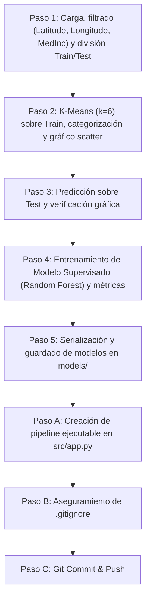

# Implementation Plan: Sistema de Agrupación y Clasificación de Casas (California Housing)

## 🎯 1. Objetivo del Proyecto
Construir un sistema de clasificación y segmentación de viviendas en California en base a su ubicación espacial (`Latitude`, `Longitude`) y el nivel de ingresos medio de la zona (`MedInc`), simulando el ciclo completo de Machine Learning:
1. Etiquetado automático de datos no etiquetados mediante aprendizaje no supervisado (**K-Means**).
2. Modelado predictivo de dichas agrupaciones con aprendizaje supervisado (**Random Forest Classifier**).
3. Persistencia y automatización de la inferencia de ambos modelos.

---

## 🛠️ 2. Pila Tecnológica y Entorno
* **Lenguaje:** Python 3.12 (CPython 3.12.8) en entorno virtual local `.venv/`.
* **Librerías principales:**
  * `pandas` & `numpy`: Procesamiento y manipulación de datos tabulares.
  * `scikit-learn`: Modelos de clustering (`KMeans`), clasificación (`RandomForestClassifier`) y métricas (`accuracy_score`, `classification_report`, `confusion_matrix`).
  * `matplotlib` & `seaborn`: Diagramas de dispersión geográficos y mapas de calor.
  * `joblib`: Serialización y persistencia de modelos.

---

## 📋 3. Fases del Plan de Implementación



### Paso 1: Carga y Preparación del Dataset
* **Descarga:** Obtención automática de `housing.csv` desde el repositorio remoto y almacenamiento en `data/raw/housing.csv`.
* **Filtrado:** Selección estricta de las columnas de interés: `Latitude`, `Longitude` y `MedInc`.
* **División:** Partición estratificada / reproducible en 80% entrenamiento (`X_train`: 16,512 filas) y 20% prueba (`X_test`: 4,128 filas) con semilla fija (`random_state=42`).

### Paso 2: Construcción y Entrenamiento de K-Means (No Supervisado)
* **Instanciación:** `KMeans(n_clusters=6, random_state=42, n_init="auto")`.
* **Entrenamiento:** Ajuste (`fit_predict`) exclusivo sobre `X_train`.
* **Categorización:** Creación de la columna `cluster` y tipado a formato `category`.
* **Visualización:** Gráfico de dispersión geográfico (`Longitude` vs `Latitude`) con diferenciación cromática de los 6 clusters y centroides marcados con `X`.
* **Interpretación:** Segmentación clara entre zonas urbanas del sur (Los Ángeles, dividida en ingresos bajos, medios y altos), zonas del norte (Bay Area vs. Valle Central) y clusters atípicos de muy altos ingresos.

### Paso 3: Predicción en Test y Validación de Consistencia
* **Inferencia:** Aplicación de `kmeans.predict(X_test)`.
* **Validación Gráfica:** Superposición de las muestras de prueba sobre las de entrenamiento (con borde diferenciado) para confirmar la coherencia de las fronteras espaciales.
* **Verificación de Medias:** Comparación de promedios de `Latitude`, `Longitude` y `MedInc` por cluster entre Train y Test, comprobando que no existe discrepancia distributiva.

### Paso 4: Entrenamiento del Modelo de Clasificación Supervisada
* **Definición de Variables:**
  * Variables predictoras ($X$): `["Latitude", "Longitude", "MedInc"]`.
  * Variable objetivo ($y$): columna categórica `cluster`.
* **Modelo Seleccionado:** `RandomForestClassifier(n_estimators=100, max_depth=10, random_state=42)`.
* **Resultados Obtenidos:**
  * **Accuracy en Train:** 99.96%
  * **Accuracy en Test:** 99.54%
  * **Métricas:** F1-score entre 0.98 y 1.00 en todas las clases.
  * **Matriz de Confusión:** Prácticamente diagonal, ratificando que el ensamble de árboles replica con total fidelidad las fronteras de Voronoi generadas por K-Means.

### Paso 5: Almacenamiento y Persistencia de Modelos y Datos
* **Modelos Serializados:**
  * `models/kmeans_clusters_6.joblib` (K-Means no supervisado).
  * `models/random_forest_classifier.joblib` (Random Forest supervisado).
* **Datasets Procesados Guardados:**
  * `data/processed/housing_train_clustered.csv`
  * `data/processed/housing_test_clustered.csv`
* **Test de Inferencia:** Comprobación de carga desde disco (`joblib.load`) sobre una muestra ficticia, confirmando predicciones idénticas entre ambos modelos.

### Paso A: Automatización Ejecutable en `src/app.py`
* Script autocontenido que ejecuta el pipeline completo sin intervención humana:
  `python src/app.py`

### Paso B: Protección del Repositorio (`.gitignore`)
* Configuración de reglas para ignorar entornos virtuales (`.venv/`), archivos compilados (`__pycache__/`) y checkpoints de Jupyter.

---

## 📊 4. Estructura Final de Archivos
```
Tutorial-K-Medias-machine-learning-python-template/
├── .github/
│   ├── strategy.md
│   └── implementation_plan.md
├── data/
│   ├── raw/
│   │   └── housing.csv
│   └── processed/
│       ├── housing_train_clustered.csv
│       └── housing_test_clustered.csv
├── models/
│   ├── kmeans_clusters_6.joblib
│   └── random_forest_classifier.joblib
├── src/
│   ├── app.py
│   ├── explore.ipynb
│   └── utils.py
├── .gitignore
├── requirements.txt
└── README.md
```

---

## 🚀 5. Instrucciones de Entrega
1. Confirmar los cambios en Git:
   ```bash
   git add .
   git commit -m "Solución completa: K-Means y clasificación supervisada California Housing"
   git push origin main
   ```
2. Compartir la URL del repositorio en la plataforma educativa **4Geeks.com**.
